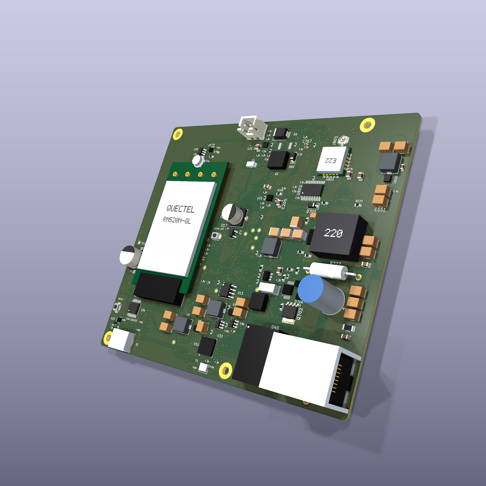
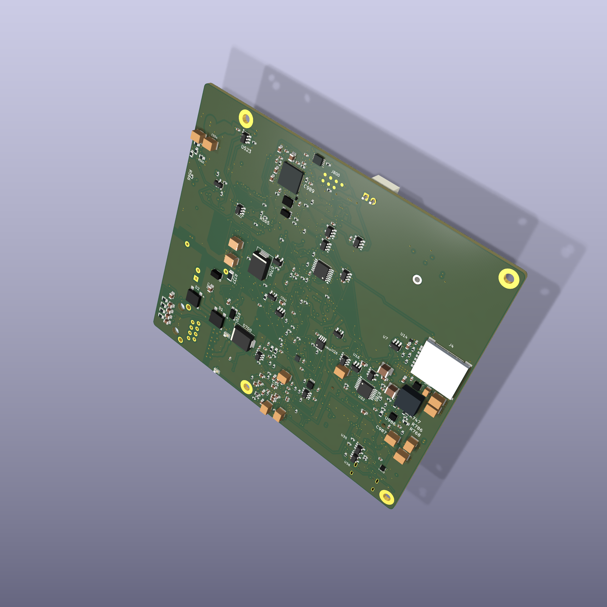

# RM520N Carrier

A six-layer carrier for the Quectel RM520N-GL, with 2.5 GbE, physical SIM and soldered eUICC, and an independent LoRa management controller.

**Revision A is a first-prototype release.** The layout is fully routed and the fabrication package is published. Supplier CAM acceptance, assembled-board testing, management firmware, and the remote LoRa network remain to be completed. See [validation status](docs/validation.md) before ordering.

| Front | Back |
| --- | --- |
|  |  |

These are CAD assembly renders. The installed modem and component bodies show the intended arrangement; they do not establish production fit or measured operation.

## Hardware

| Item | Revision A |
| --- | --- |
| PCB | 110 × 96 mm; six copper layers; nominal 1.6 mm; ENIG |
| Modem | M.2 Key B socket for RM520N-GL; modem purchased separately |
| Ethernet | RTL8125BG PCIe controller, separate magnetics, front-face RJ45 |
| Power input | Regulated 48 V ±5% passive PoE, or 12 V ±5% through J2 |
| Management | ESP32-S3FN8 on an independent always-on rail |
| Radio | E22-900MM22S SPI LoRa module; intended US 915 MHz network |
| SIM | Back-face nano-SIM at the left edge, viewed from the front; experimental ST4SIM-300M eUICC population |
| Service | USB-C service connection and controlled internal USB host ownership |
| Assembly | 423 fitted parts: 419 SMT and four through-hole |

The passive input **does not negotiate IEEE PoE, PoE+, or PoE++**. It shares system ground with the other interfaces and has no galvanically isolated power converter. Use the specified SELV supply/injector and verify its pinout, polarity, and voltage. J2 pin 1 is positive; pin 2 is ground.

The modem rail targets **3 A continuous at 0–40 °C**, subject to the measured efficiency, cooling, copper, ripple, and input-current requirements. Initial sustained 4 A qualification must start at or below 20 °C. Neither value is an established assembled-board rating. [Power requirements](manufacturing/rev-a/requirements/POWER_TARGETS_AND_RECOVERY.txt) define the acceptance limits.

The management rail stays powered during modem power cycling. Firmware is not included in this release. USB AT access, modem Ethernet operation, eUICC provisioning, and any SSH or console service depend on the exact modem firmware and need hardware verification. LoRa recovery and telemetry are planned software functions.

## Files and downloads

Use the [Rev A release](https://github.com/ripclap/rm520n-carrier/releases/tag/rev-a) for a fixed revision, or clone the repository:

```sh
git clone https://github.com/ripclap/rm520n-carrier.git
cd rm520n-carrier
git checkout rev-a
```

Open [hardware/rev-a/carrier.kicad_pro](hardware/rev-a/carrier.kicad_pro) in **KiCad 10**. The project includes its schematics, PCB, design rules, symbols, footprints, and model assets. Native KiCad files are the editable design source.

| Path | Contents |
| --- | --- |
| [hardware/rev-a/](hardware/rev-a/) | Authoritative schematics, PCB, rules, and local libraries |
| [hardware/assembly-preview/](hardware/assembly-preview/) | Presentation model with an installed modem; use the native Rev A PCB for fabrication |
| [manufacturing/rev-a/fabrication/](manufacturing/rev-a/fabrication/) | Six-layer Gerbers, drills, drill maps, and IPC-D-356 netlist |
| [manufacturing/rev-a/assembly/](manufacturing/rev-a/assembly/) | BOM, SMT and manual placements, and front/back drawings |
| [manufacturing/rev-a/requirements/](manufacturing/rev-a/requirements/) | Fabrication process, site schedules, power limits, and first-article procedure |
| [manufacturing/rev-a/verification/](manufacturing/rev-a/verification/) | Public-release checks and recorded dispositions |

Download the [BOM workbook](manufacturing/rev-a/assembly/RM520N-Carrier-RevA-BOM.xlsx) or [unpriced factory BOM](manufacturing/rev-a/assembly/Factory-BOM-unpriced.csv). The component model dated **2026-10-12** is **$101.60 per board at 25** or **$85.31 at 100**, excluding the Quectel, PCB fabrication, assembly, test, shipping, taxes, enclosure, antennas, and provisioning. Prices and availability require a new quote.

The [schematic PDF](docs/schematic.pdf) is available for review without KiCad. Verify a downloaded copy with `python3 tools/verify_release.py`; the [manifest](manifest.json) and [SHA256SUMS](SHA256SUMS) identify this release.

## Building a prototype

1. Read [fabrication and assembly](docs/fabrication.md) and obtain the fabricator's acceptance of the exact stack, impedance, drill, fill/cap, cover, and finished-metal requirements. This is not a generic six-layer order.
2. Send the complete fabrication, assembly, and requirement folders for the same revision. Include both SMT and manual through-hole placement files. Review every proposed substitution.
3. Inspect the received board and complete [bring-up](docs/bring-up.md) with a dummy load before installing the modem.
4. Record the tested hardware, modem firmware, power source, fixtures, and waveforms. Qualify the data interfaces, radio, SIM, enclosure, and recovery firmware before making a larger lot.

See [architecture](docs/architecture.md) for the power and management paths and [CONTRIBUTING.md](CONTRIBUTING.md) for design changes and test reports.

## License

Original hardware design files are licensed under **CERN-OHL-P-2.0**. Original documentation and renders are **CC-BY-4.0**; repository tools are **MIT**. Third-party libraries and assets retain their own licenses and notices. See [LICENSE](LICENSE) and [LICENSES/](LICENSES/).
